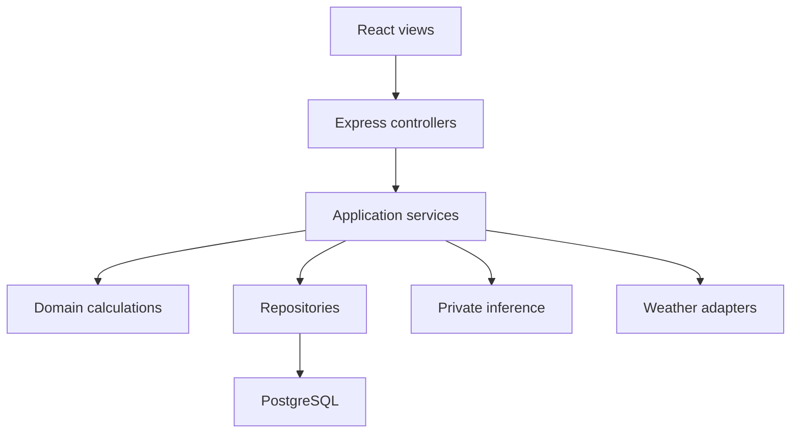

# Architecture decisions

## Three tiers and MVC are different views

| Logical tier | Responsibility | Implementation |
|---|---|---|
| Presentation | User interaction and report display | `frontend/src`: React views, forms, charts, API client |
| Application | Authentication, ownership, planning and prediction | Express controllers/services/domain; private Python inference component |
| Data | Durable state and integrity | PostgreSQL plus versioned model JSON and snapshots |

The private Python process is a component of the application tier. Five Docker containers do not turn this into five logical tiers. MVC describes the division inside the application: React supplies the browser view, Express controllers translate requests, and domain/services/repositories supply model behavior and state. The domain model includes rules, not only database tables.

## ADR 001: modular Express application

Controllers contain HTTP validation and response codes. `PlanningService` handles orchestration and ownership. Finance functions are pure and independent of Express/SQL. Provider clients implement the same normalized boundary. `createApp` accepts dependencies, so API tests run without network calls or a real ML server. PostgreSQL integration tests separately check database guarantees. This keeps an explainable portfolio-sized architecture while preserving replacement seams.

## ADR 002: PostgreSQL with owner-scoped repositories

Users, sessions, sites, scenarios and estimates have relational keys. Site/scenario ownership is enforced both by service checks and composite foreign keys. JSONB stores versioned scenario/report payloads without losing relational ownership. All dynamic table names are whitelist-controlled; values are SQL parameters. Reports capture site and scenario snapshots and cannot be updated through the API. Deleting a property intentionally deletes its dependent proposals/reports.

JSONB trades flexible report evolution for weaker per-field SQL checks; Zod performs strict input validation. Schema migrations currently contain a single additive, idempotent initial migration under a PostgreSQL advisory lock. Add a migration-history table and sequenced forward migrations before further database changes. Do not use destructive migrations with automated application rollback.

## ADR 003: sessions and request integrity

Passwords use Node scrypt with independent random salts. The browser has an opaque random HttpOnly, SameSite=Lax cookie; only a SHA-256 digest of the session token is stored server-side. Production cookies are Secure. The API returns a separate session CSRF token and checks it for authenticated mutations, alongside Origin. Login/register validate Origin when present. Sessions last seven days and logout invalidates the stored session. Production instances share PostgreSQL sessions; in-memory rate limits and provider caches remain per process.

Configure trusted proxies only for the actual network path. The included single-proxy setting assumes Caddy directly forwards to Express. Behind CloudFront, Caddy must trust only verified CloudFront proxy ranges if forwarding viewer IPs for meaningful per-user IP rate limits. Otherwise those limits group requests by edge/origin address. Add a distributed limiter before horizontal scaling.

## ADR 004: two separate prediction contracts

`plant-linear-chrono-v1` preserves the notebook's two features (irradiation and irradiation × ambient temperature), with train-only scaling, a train-only peak target reference and chronological evaluation. It is a research model, not a household sizing algorithm.

`pv-physics-v1` takes location, panel nameplate kWp, inverter kW, tilt, north-clockwise azimuth, losses and irradiance. It transposes irradiance onto a fixed panel, estimates cell temperature with Faiman, applies PVWatts DC response, losses, 96% inverter efficiency and clipping. Monthly planning approximates one representative day per month using NASA daily GHI. Forecasts use hourly GHI/DNI/DHI means with midpoint solar position. Long-term uncertainties and shading geometry are not calibrated.

## ADR 005: resilience without hidden substitutions

Primary forecast is Open-Meteo; optional independent fallback is OpenWeather Solar 2.0 combined with One Call 3.0 temperature/wind. API credentials stay on the server. Separate process-wide circuit breakers isolate providers. Cache keys include coordinates and exact requested window; pending calls coalesce; stale resources retain original fetch timestamps and warnings. Invalid values and units are rejected. Demo mode is explicitly synthetic. Readiness checks PostgreSQL and inference locally, not public weather availability.

No independent second climatology provider is implemented; NASA planning fails clearly when no usable cached resource exists. This avoids using short-term forecasts as annual climate data.

## ADR 006: deploy small, scale with evidence

Initially use one EC2 host for API, inference and database with Docker isolation, plus S3/CloudFront for static UI. This is a single failure domain and does not claim high availability. Estimate memory/load before selecting an instance. Later move PostgreSQL to a managed database, share cache/rate-limit state, and scale stateless API/inference independently when load results justify the extra cost. Keep frontend and backend source folders separate even if hosted together locally.
