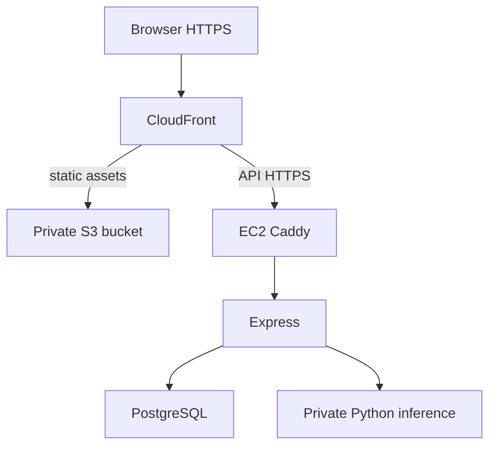

# AWS hosting and free-tier plan

Verified against AWS and GitHub documentation on 14 October 2026. No account, billable resource or public deployment was created during this work.

## Can EC2 + S3 + CloudFront host this application?

Yes. S3 holds the built React assets and CloudFront delivers them over HTTPS. EC2 runs the Express API, private Python inference, PostgreSQL and Caddy reverse proxy. This is a practical learning/portfolio topology. The static frontend can use a $0 CloudFront plan, but EC2 is **not an indefinitely free backend**.

| Account/offer | Current terms | Effect on this project |
|---|---|---|
| New AWS customer on/after 15 July 2025 | $100 sign-up credit; up to $100 additional credit from eligible activities. Free account plan expires after six months or credits run out, whichever comes first. | Use for a time-limited portfolio deployment; confirm the console's balance, allowed services and expiry. A paid account plan can incur charges beyond credits. |
| Account created before 15 July 2025 | Legacy EC2 offer lasted 12 months with service-specific limits. | By October 2026, such accounts are beyond that 12-month EC2 trial. Do not budget using the old “750 free hours” assumption. |
| CloudFront Free flat-rate plan | $0/month, baseline 1 million requests and 100 GB viewer transfer/month; 5 GB S3 Standard storage credits. | Good fit for a small React app. This is separate from the overall AWS Free account plan; eligibility/restrictions must be checked. |

CloudFront's documented flat-rate plan has no overage charges, but sustained excessive usage can lead to delivery adjustments. Its S3 storage credit does not make all S3 operations/storage classes, EC2, EBS, backups or domain registrations free. Public IPv4 normally costs $0.005/hour before eligible credits/offers (~$3.65 for 730 hours). Budget compute, volumes, snapshots, S3 operations and traffic too. Choose the actual **Free flat-rate** distribution plan in the console; do not confuse it with pay-as-you-go CloudFront allowances or the AWS account's Free plan.

Recommendation: use the AWS Free account plan if you qualify and want a six-month learning deployment with no charges until you upgrade. Set expiry reminders and export your data before the account closes. If you already have an older account, assume a paid EC2 backend unless your Billing console explicitly shows valid credits. There is no guaranteed ongoing $0 AWS Express + Python + PostgreSQL deployment in this plan.

Keeping even the frontend online after the overall Free account plan ends requires an active account, usually by upgrading that account to the Paid plan. The CloudFront distribution can remain on its separate $0 tier, while backend and other uncovered resources can be billed. To retire a paid backend, terminate the instance and review remaining volumes, snapshots, Elastic IPs and other resources; stopping EC2 alone does not remove every charge.

## Resource sizing

Start by testing locally, then consider a credit-eligible **t3.small (2 GiB, x86_64)** for this multi-process demo. AWS currently lists it as eligible for new-program accounts, but eligible means credit-backed usage, not unlimited free hours. A 1 GiB micro instance is tight for pandas/pvlib, PostgreSQL, Node, Docker and the OS; the configured service memory ceilings alone exceed 1 GiB. Do not promise micro-instance viability before measurement.

Use one Python worker and one Node process initially. Build containers in GitHub Actions rather than on the small EC2 host. Monitor `docker stats`, free memory, disk space and OOM events during the provided k6 workload. Production Compose caps DB 256 MiB, inference 512 MiB, API 256 MiB and Caddy 128 MiB; these are starting guardrails, not measured capacity guarantees. A workload may need more RAM or stricter concurrency. The supplied CD builds x86_64 images; an ARM t4g instance requires multi-platform image builds first.

Use a single modest gp3 volume sized for images, the database and logs, with log rotation. A single-host database has no high availability. Keep encrypted off-host backups and test restoration; snapshot/storage cost is separate. A suitable region near Sri Lanka is a choice to compare for latency and pricing, not a fixed free-cost promise. Avoid introducing an ALB, NAT Gateway, ECS cluster, RDS or always-on second host for this first credit-limited setup unless you have explicitly budgeted it. Set billing/credit alerts; AWS Budgets alerts are notifications, not a hard spending cap on a paid account.

## CloudFront routing

Create a private S3 bucket with public access blocked. Use its REST origin, Origin Access Control, and a bucket policy scoped to your distribution. Do not use a public S3 website endpoint. Set the default root object to `index.html`.

| Behavior | Origin | Caching/request handling |
|---|---|---|
| Default | Private S3 | Cache hashed assets; index revalidation. Optional viewer-request rewrite `deploy/spa-rewrite.js`, attached to this behavior only. |
| `/api/*` | EC2 Caddy HTTPS | Managed `CachingDisabled`; allow required HTTP methods; managed `AllViewerExceptHostHeader` request policy forwards session cookies, Origin and x-csrf-token. |
| `/health/*` | EC2 Caddy HTTPS | CachingDisabled; readiness must not be a cached success. |

Configure an origin custom header `x-origin-verify` matching `ORIGIN_SECRET` on the EC2 origin. Express rejects direct API origin requests without it. Keep that secret out of frontend code and logs. Use HTTPS-only viewers. Never cache login responses, cookies or personalized JSON. Do not configure global 403/404 → 200/index.html error mapping, which would hide API errors. Three behaviors fit within the Free plan's documented five-behavior allowance.

For API origin HTTPS, supply a domain/subdomain you control pointing at EC2. Caddy obtains/renews its certificate via ports 80/443; DNS and inbound reachability must be correct. The CloudFront default hostname is enough for the UI, but EC2's AWS-owned public DNS name is not a domain you can use to obtain your own certificate. Domain registration is outside the free-tier promise; an existing or suitable free DNS hostname can avoid buying a domain if you can control its records. Do not serve real user credentials over an unencrypted CloudFront-to-EC2 origin merely to avoid this requirement.

Keep PostgreSQL and inference unpublished; API listens through Caddy. Security group: 80/443 as required for HTTPS and certificate issuance; no public 3001, 5432 or 8000. Use Systems Manager for management/deployment instead of opening SSH to GitHub-hosted runners. Configure Caddy's trusted proxy ranges for CloudFront before claiming viewer-IP based rate limiting; the default setup only knows the immediate origin/edge address.

## Deploy the supplied source

1. Merge the FE and BE folders into your repository root (or use the full ZIP). Run initial installs, commit both npm lockfiles and push. Run CI successfully first.
2. In your AWS console, verify eligibility/credits and choose the account plan deliberately. Create EC2 with adequate memory, encryption and the required security group. Install Docker/Compose and enable the SSM agent. Give EC2 the managed instance role needed for Systems Manager; verify it is online before using CD.
3. Copy `deploy/compose.production.yaml`, `deploy/Caddyfile`, `deploy/release.sh` and the example production environment to `/opt/sunyield/deploy`. Save secrets as `production.env` with mode 600; make `release.sh` executable. Use different random hex values for password, service key and origin secret. Configure real `APP_ORIGIN` and `API_HOST`. Keep resource mode demo for the first smoke run.
4. Make the GitHub container packages public for free public pulls, or configure read-only registry authentication on EC2. CD publishes immutable digests; it does not store a registry credential on your host automatically. Repository source code and production secrets remain separate.
5. Create the private S3/CloudFront setup above. Upload an initial tested frontend build. Verify the API behavior and TLS manually. Use a dedicated smoke account created through the public UI.
6. Add GitHub's AWS OIDC identity provider (`token.actions.githubusercontent.com`, audience `sts.amazonaws.com`). Use the supplied trust/policy examples after replacing all account/resource placeholders. Restrict trust to your exact repository and **production environment**, not a wildcard repository. Repositories created after 15 July 2026 or opting into immutable subjects include owner/repository IDs in `sub`; match your actual format. The trust example shows the legacy format, not a universal value.
7. Configure the GitHub environment `production`, restrict deployments to main, and enable reviewers if your plan supports them. Add variables `AWS_DEPLOY_ROLE_ARN`, `AWS_REGION`, `EC2_INSTANCE_ID`, `FRONTEND_BUCKET`, `CLOUDFRONT_DISTRIBUTION_ID`, `PUBLIC_URL`; add environment secrets `SMOKE_EMAIL`, `SMOKE_PASSWORD`. Set repository variable `ENABLE_CD=true` only after configuration. No long-lived AWS access keys are needed.
8. Push a small change to main. Successful CI triggers CD: it checks committed locks, downloads the tested frontend artifact from that exact run, builds API/ML digest images, assumes AWS role, executes the host release via SSM, publishes assets then index, invalidates index and runs an authenticated save/calculate/delete smoke.

Do not send public test traffic to expensive provider endpoints; demo mode is useful for release smoke and load tests. A live deployment smoke deliberately depends on public provider availability. Configure licensed weather access when moving beyond an educational/noncommercial demo.

The host release script serializes releases and restores previous application images when pull/migration/start/readiness fails. This assumes additive backward-compatible schema changes. It does **not** automatically roll back the database or frontend, and a later authenticated smoke failure marks CD failed without an automatic full-stack reversal. Preserve the previous static index and assets before releasing, then explicitly restore them and the previous image manifest if the smoke fails. First release has no prior version to restore. SSM's default waiter can time out during large image pulls; inspect command status before retrying an uncertain deployment. Initial infrastructure is configured manually; no Terraform or AWS resources were generated/applied here.

## Sources

- [AWS Free Tier](https://aws.amazon.com/free/) and [Billing Free Tier FAQ](https://docs.aws.amazon.com/awsaccountbilling/latest/aboutv2/free-tier-FAQ.html)
- [EC2 Free Tier by account date](https://docs.aws.amazon.com/AWSEC2/latest/UserGuide/ec2-free-tier-usage.html)
- [CloudFront flat-rate plans, features, storage credits and allowances](https://docs.aws.amazon.com/AmazonCloudFront/latest/DeveloperGuide/flat-rate-pricing-plan.html)
- [CloudFront plan prices](https://docs.aws.amazon.com/PricingPlanManager/latest/UserGuide/plans.html)
- [Public IPv4 pricing](https://aws.amazon.com/vpc/pricing/)
- [GitHub OIDC for AWS and immutable subject formats](https://docs.github.com/en/actions/how-tos/secure-your-work/security-harden-deployments/oidc-in-aws)
- [Open-Meteo terms](https://open-meteo.com/en/terms), [NASA POWER climate API](https://power.larc.nasa.gov/docs/services/api/temporal/climatology/), [OpenWeather solar documentation](https://openweathermap.org/api/solar-radiation)
